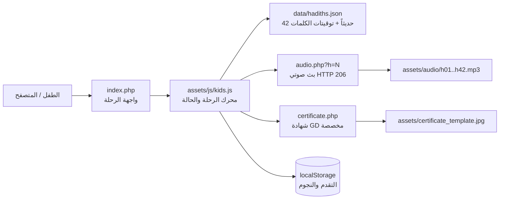

# الأربعون النووية للأطفال — Nawawi Kids Story Journey

<p align="center">
  
  
  
</p>

<p align="center">
  <b>رحلة قصصية تفاعلية لحفظ وفهم الأربعين النووية للأطفال من ٦ إلى ١٢ سنة</b><br>
  An interactive storybook journey that helps children (6–12) listen to, understand, memorize and master Imam An-Nawawi's 42 Hadiths.
</p>

<p align="center">
  
  
  
  
  
</p>

---

## نظرة عامة

يرافق الطفلَ صديقا الرحلة **عمر ومريم** عبر **أربعة عوالم** (فصول)، وفي كل فصل محطات متتالية على طريق متعرّج؛ كل محطة حديث نبوي يمرّ فيه الطفل بأربع خطوات، ويربح **نجمة ذهبية** تفتح المحطة التالية، حتى يجمع النجوم الـ ٤٢ فيفتح **صندوق الكنز** ويحصل على **شهادة تقدير باسمه**.

| الفصل | العالم | المحطات |
| :--- | :--- | :--- |
| الأول | عالم الإخلاص (أركان الإسلام والإخلاص) | ١ – ١٠ |
| الثاني | حديقة الأخلاق (مكارم الأخلاق وحب الخير) | ١١ – ٢٠ |
| الثالث | واحة الطاعات (الاستقامة وأبواب الخير) | ٢١ – ٣١ |
| الرابع | سماء الآداب (آداب المسلم وسعة رحمة الله) | ٣٢ – ٤٢ |

### خطوات كل محطة

1. **استمع** — تلاوة صوتية مع تتبّع كلمة بكلمة (كاريوكي)، والضغط على أي كلمة يقفز لموضعها، مع التحكم بالسرعة والتكرار.
2. **افهم** — المعنى العام، معاني الكلمات الغريبة، والدروس المستفادة (طبعة دار المنهاج).
3. **احفظ** — إخفاء تدريجي للكلمات (٣٥٪ / ٧٠٪ / ١٠٠٪)، تلميح أول حرف، وتسجيل صوت الطفل ومقارنته بالقارئ.
4. **العب واربح** — ٣ تدريبات لكل حديث (١٢٦ تدريباً)، والإجابة الصحيحة عليها جميعاً تفتح المحطة التالية.

## المعمارية



- **بدون قاعدة بيانات:** تقدّم الطفل يُحفظ في `localStorage` على جهازه.
- **وضعان للتشغيل:** مستقل على أي استضافة PHP، أو مدمج داخل منصة أكاديمية الجوهري (يقرأ اسم الطالب المسجّل تلقائياً عبر `bootstrap.php`).
- **وضع المعلم / ولي الأمر:** يفتح كل المحطات للاستعراض دون قيود.

## التشغيل السريع

```bash
git clone https://github.com/ssssshyu53/nawawi-kids.git
cd nawawi-kids
php -S 127.0.0.1:8080
# افتح http://127.0.0.1:8080/
```

المتطلبات: PHP 8.1+ مع امتدادي `gd` (مع FreeType) و `mbstring`. اختيارياً: `composer require khaled.alshamaa/ar-php` لتشكيل عربي أدقّ في الشهادة.

## هيكل المشروع

```
├── index.php               # واجهة الرحلة القصصية (صفحة واحدة)
├── audio.php               # بث MP3 بنطاقات البايت (HTTP 206)
├── certificate.php         # توليد شهادة PNG باسم الطفل
├── bootstrap.php           # كشف الوضع المستقل/المدمج + تحميل المكتبات
├── lib/ArabicGlyphs.php    # تشكيل الحروف العربية الاحتياطي لـ GD
├── data/hadiths.json       # المتون، التوقيتات، المعاني، الدروس، التدريبات
└── assets/
    ├── css/kids.css        # هوية بصرية طفولية + الطريق المتعرج
    ├── js/kids.js          # الحالة، الخريطة، المشغّل، الحفظ، التدريبات
    ├── audio/              # h01.mp3 … h42.mp3
    ├── posters/            # لوحات الأحاديث ١–١٣
    ├── img/                # شخصيات الرحلة ومشاهد الفصول الأربعة
    └── fonts/              # Cairo / Amiri (OFL)
```

## الأمان والخصوصية

- لا تُجمع أي بيانات شخصية على الخادم؛ الاسم والتقدم يبقيان في متصفح الطفل.
- مدخلات الشهادة تُنقّى (`strip_tags`، إزالة محارف التحكم، حدّ أقصى للطول) قبل الرسم.
- `audio.php` يقبل فقط معرّفات من ١ إلى ٤٢ ولا يقرأ أي مسار خارجي.
- `.htaccess` يمنع فهرسة المجلدات والوصول المباشر إلى `lib/` و `bootstrap.php`.
- الصفحة موسومة `noindex, nofollow` لأنها رابط خاص.

## التوثيق

- [docs/ARCHITECTURE.md](docs/ARCHITECTURE.md) — المعمارية وتدفق البيانات ومخطط JSON.
- [docs/MODULES_GUIDE.md](docs/MODULES_GUIDE.md) — شرح كل وحدة وقواعد الفتح والحفظ.
- [docs/DEPLOYMENT_GUIDE.md](docs/DEPLOYMENT_GUIDE.md) — النشر على cPanel / VPS / داخل الأكاديمية.
- [docs/DEVELOPER_HANDOVER.md](docs/DEVELOPER_HANDOVER.md) — دليل المطوّر الجديد.

---

© أكاديمية الشيخ أحمد الجوهري للعلوم الشرعية — جميع الحقوق محفوظة.
