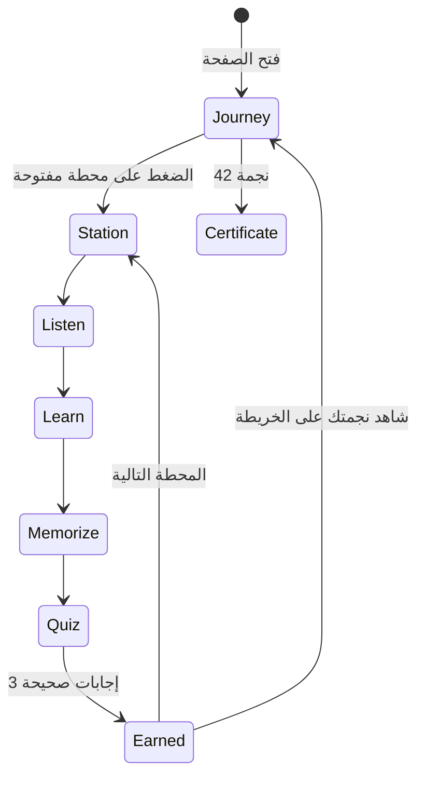
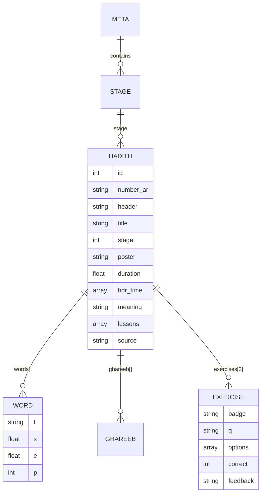

# المعمارية — Architecture

## 1. الطبقات

| الطبقة | الملفات | المسؤولية |
| :--- | :--- | :--- |
| العرض | `index.php`, `assets/css/kids.css` | هيكل HTML للصفحة الواحدة (خريطة الرحلة + المحطة + النوافذ) |
| المنطق | `assets/js/kids.js` | إدارة الحالة، رسم الطريق المتعرج، المشغّل والمزامنة، الحفظ، التدريبات |
| البيانات | `data/hadiths.json` | محتوى ثابت للقراءة فقط |
| الخادم | `audio.php`, `certificate.php`, `bootstrap.php` | بث الصوت بالنطاقات، توليد الشهادة، كشف الوضع |

## 2. تدفق الرحلة



## 3. الحالة المحلية (localStorage)

المفتاح: `algohari_nawawi_kids_v1`

```json
{
  "completedIds": [1, 2],
  "unlockedUpTo": 3,
  "currentId": 3,
  "teacherMode": false,
  "sfxMuted": false,
  "fontSize": "md",
  "studentName": "يوسف"
}
```

قاعدة الفتح: المحطة `n` مفتوحة إذا `n <= unlockedUpTo` أو كانت منجزة أو كان وضع المعلم مفعّلاً.

## 4. مخطط `data/hadiths.json`



## 5. بث الصوت

`audio.php?h=N` يعيد `206 Partial Content` مع `Content-Range` و `Accept-Ranges: bytes`، مما يجعل القفز إلى أي كلمة دقيقاً حتى على الخوادم التي لا تدعم النطاقات للملفات الثابتة (مثل `php -S`).

## 6. ملف الأمان

| التهديد | المعالجة |
| :--- | :--- |
| Path traversal | `audio.php` يحوّل المعرّف إلى `int` ويقيده بين 1 و42 |
| XSS في الشهادة | تُرسم النصوص كصورة GD بعد `strip_tags` وإزالة محارف التحكم |
| XSS في الواجهة | كل نص ديناميكي يمر عبر `escapeHtml()` قبل الإدراج |
| كشف ملفات داخلية | `.htaccess` يمنع `lib/`, `docs/`, `bootstrap.php` |
| جمع بيانات الأطفال | لا تخزين على الخادم إطلاقاً |
